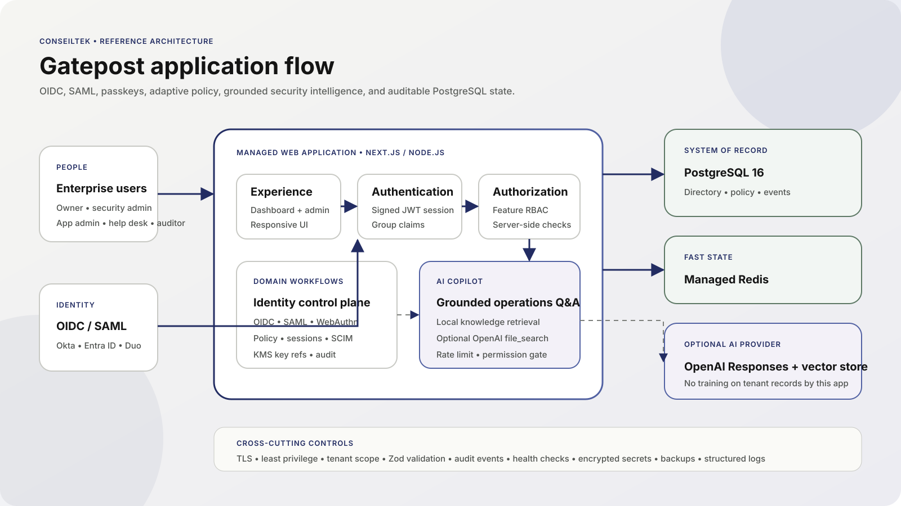

<p align="center"></p>
<h1 align="center">Gatepost</h1>
<p align="center"><strong>Single sign-on you run, on keys you hold.</strong></p>

[](https://github.com/ConseilTek-Tektons/gatepost/actions/workflows/ci.yml) [](https://github.com/ConseilTek-Tektons/gatepost/actions/workflows/codeql.yml) [](LICENSE)

Gatepost is a deployable workforce-identity control-plane reference application for OIDC, OAuth 2.1, SAML, passkeys, adaptive policy, SCIM, sessions, event retention, and customer-held signing keys. See the [product rationale and honest parity matrix](https://conseiltek.com/techtons/gatepost).



## Working scope

- PostgreSQL directory, application, policy, session, authentication-event, signing-key metadata, and audit models
- Server-authorized `/api/applications` workflow and tested adaptive-policy evaluator
- Delegated feature RBAC for owners, security administrators, directory administrators, application administrators, help desk, auditors, and viewers
- Application federation and migration guidance for Okta, Entra ID, Duo, OIDC, and SAML
- Advisory authentication-anomaly Q&A; AI is deliberately outside the token-issuance and enforcement path
- Responsive ConseilTek interface aligned with the current website design

## Important boundary

This repository is a production-oriented reference implementation and admin control plane, not a claim of completed OpenID Foundation certification. Run the official protocol conformance suites and an independent security review before using it as an authoritative identity provider.

## Run locally

```bash
cp .env.example .env.local
docker compose up -d postgres redis keycloak
pnpm install --frozen-lockfile
pnpm db:migrate && pnpm db:seed
pnpm dev
```

## Deploy

- `infra/aws`: App Runner, Aurora PostgreSQL Serverless v2, ElastiCache Serverless, KMS-compatible secret boundaries, SQS, and CloudWatch
- `infra/azure`: App Service Web App for Containers, PostgreSQL Flexible Server, Azure Managed Redis, Key Vault, private storage, and Monitor

Gatepost is not a static site. Its authenticated server routes and identity-control workflows require managed container compute.

## Documentation

[Architecture](docs/ARCHITECTURE.md) · [Authentication](docs/AUTHENTICATION.md) · [RBAC](docs/RBAC.md) · [AI](docs/AI.md) · [Security](docs/SECURITY.md) · [Operations](docs/OPERATIONS.md)

Gatepost is designed, built, and maintained by [ConseilTek](https://conseiltek.com) under Apache 2.0. Contact [support@conseiltek.com](mailto:support@conseiltek.com).
