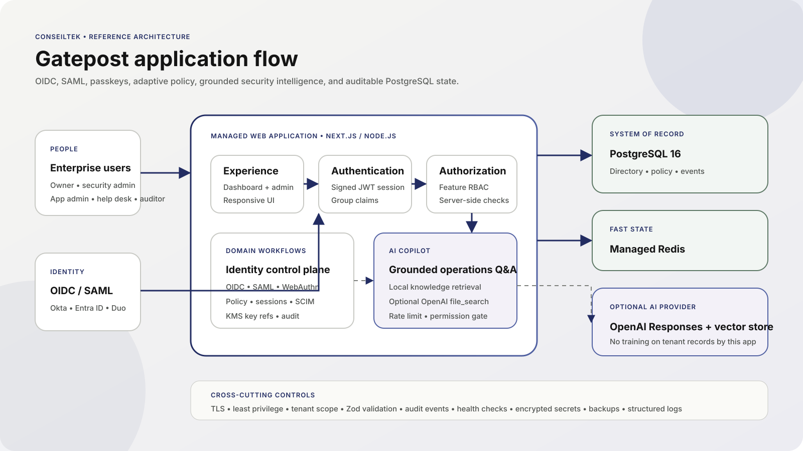
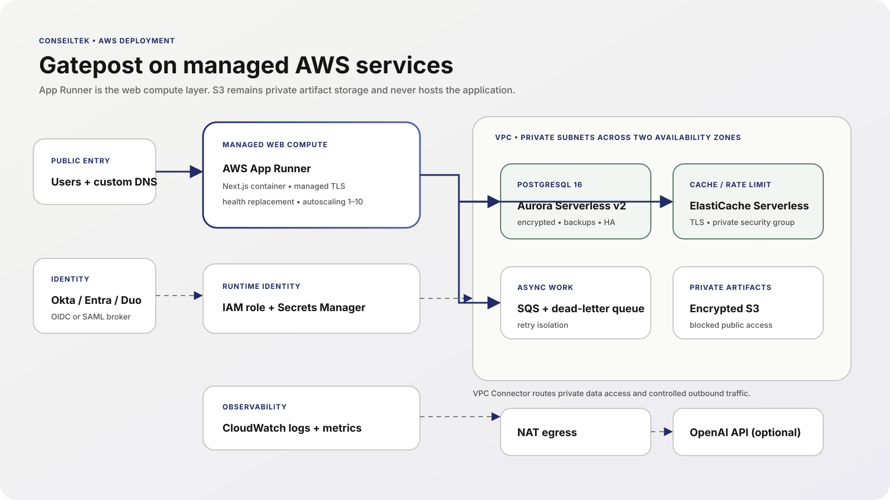
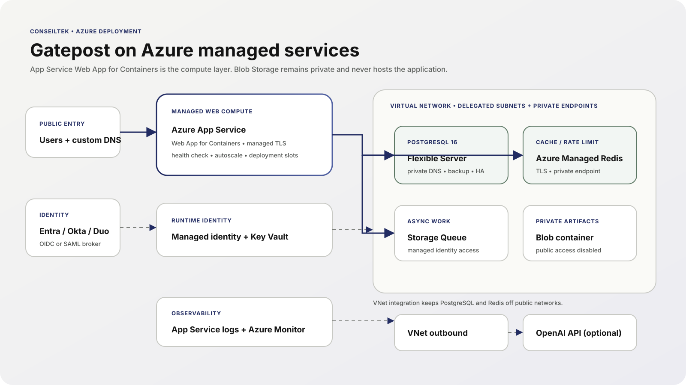

# Gatepost architecture

Gatepost separates the identity administration plane from protocol enforcement. This repository provides the working admin application, directory/application/policy/session/event data model, tested policy logic, enterprise federation pattern, and managed-cloud deployment. A production identity-provider rollout also requires protocol conformance certification, independent cryptographic review, availability engineering, and incident exercises.

Directory, application, policy, session, authentication-event, signing-key metadata, and audit records live in PostgreSQL 16. Signing-key references point to customer-controlled KMS or Key Vault; private key material must never enter application memory. AI anomaly explanations run outside the allow/block path and have no identity mutation tools.

AWS uses managed container compute, Aurora PostgreSQL, ElastiCache, queues, private storage, secret management, and CloudWatch. Azure uses App Service Web App for Containers, PostgreSQL Flexible Server, Azure Managed Redis, Key Vault, private Blob Storage, queues, and Monitor.

Gatepost is an authenticated server system, never a static website deployment.
